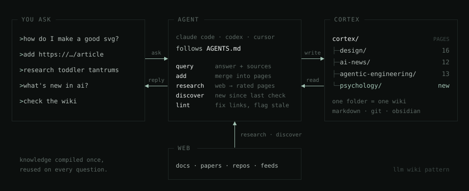

<picture>
  <source media="(prefers-color-scheme: dark)" srcset="assets/logo-dark.svg">
  
</picture>

# Cortex

**Personal knowledge base maintained by an LLM agent. A topic-based LLM wiki, Karpathy pattern.**
You ask. The agent researches, writes it down as linked Markdown pages, and keeps it current. Next time you ask, the answer is already there. With sources.



## Why

- There is too much new stuff to read and remember. You can't keep it all in your head.
- Your agent re-researches the same things in every chat. It takes time, and the result disappears into chat history.
- Cortex fixes both: knowledge is compiled once, stored in plain Markdown in git, and reused on every question.

It follows Andrej Karpathy's [LLM Wiki](https://gist.github.com/karpathy/442a6bf555914893e9891c11519de94f) pattern, split into topics: each folder is its own small wiki. Topics stay small, and one question can still draw from several of them.

## Everyday use cases

- **Learning a craft.** You build websites and want better illustrations. You ask *"How do I make good SVGs?"*. The first time, the agent researches papers and guides and writes a process page: plan the scene, draw with simple shapes, render, fix, add curves last. Every later SVG task starts from that page.
- **Keeping up with AI.** You ask *"What's new in AI?"* once a week. The agent checks release feeds, Hacker News and trending repos since the last check. You get a short list instead of 200 open tabs.
- **Parenting.** Your 4-year-old has tantrums. You ask *"Research how to handle tantrums"*. The agent collects child-psychology sources, rates them and writes a few pages. A month later, *"What did we learn about bedtime fights?"* takes seconds.
- **Home renovation.** You add a manufacturer PDF and three articles about heat pumps. Later you ask *"Heat pump or gas boiler for a 120 m² house?"* and get an answer built from your own sources.
- **Health questions.** *"What does research say about caffeine and sleep?"* Pages cite studies and mark claims that sources dispute. It is not medical advice. It is a well-sourced starting point.
- **Reading a book.** You add chapter notes as you read. The agent builds pages for ideas, people and connections between them.
- **Trip planning.** *"Research Japan in April with kids."* Places, transport passes and prices land in one topic you can query while you travel.

## How it works

- **Topics are folders.** `design/`, `ai-news/`, `psychology/` … Each has `index.md` (a catalog of pages), `sources.md` (where to look when researching) and the pages themselves.
- **Two kinds of pages.** Concept pages hold one idea, tool or technique each. Process pages hold step-by-step "how to do X", built from the concept pages.
- **You talk normally.** No commands. The agent picks the operation:

| You say | The agent |
|---|---|
| "How do I …?" / "What do I know about …?" | answers from the wiki, offers research if something is missing |
| "Add this: `<url or file>`" | reads it and merges new knowledge into pages |
| "Research X" | searches the web, rates sources, writes pages |
| "What's new in X?" | checks the topic's sources since the last check |
| "Check the wiki" | fixes broken links and reports stale or conflicting pages |
| "New topic X" | creates the folder and finds the best sources to follow |

- **Every fact has a source.** Sources are rated high / medium / low. Contradictions are marked, not silently overwritten.
- **Your language.** The agent writes the wiki in the language you speak.
- **Plain Markdown in git.** Links work on GitHub and in [Obsidian](https://obsidian.md). Open the folder as a vault to see the graph.

All rules live in [`AGENTS.md`](AGENTS.md). You never have to read it. The agent does.

## Install

Paste this into your agent (Claude Code, Codex, Cursor, OpenCode …):

```text
Install Cortex from https://github.com/xtompie/cortex. Follow INSTALL.md from that repo.
```

The agent clones the repo, asks whether to keep the example topics or start empty, and helps you make it your own repo.

Manual install:

```bash
git clone https://github.com/xtompie/cortex.git ~/cortex
```

## Use

Inside the folder:

```bash
cd ~/cortex
claude          # or codex, cursor, opencode …
```

From any other project, just point at it:

```text
Use my Cortex at ~/cortex. How should I design the landing page for this app?
```

## What's in this repo

Example topics, written in Polish:

- [`design/`](design/index.md): 16 pages. Web design, design with LLMs, SVG, design process.
- [`ai-news/`](ai-news/index.md): 12 pages. Models, Claude Code, coding agents, tools, trending repos.
- [`agentic-engineering/`](agentic-engineering/index.md): 13 pages. Context engineering, skills, AGENTS.md, spec-driven development.

## Credits

- Andrej Karpathy, [LLM Wiki](https://gist.github.com/karpathy/442a6bf555914893e9891c11519de94f)
- Ideas from [nvk/llm-wiki](https://github.com/nvk/llm-wiki) and [Astro-Han/karpathy-llm-wiki](https://github.com/Astro-Han/karpathy-llm-wiki)
